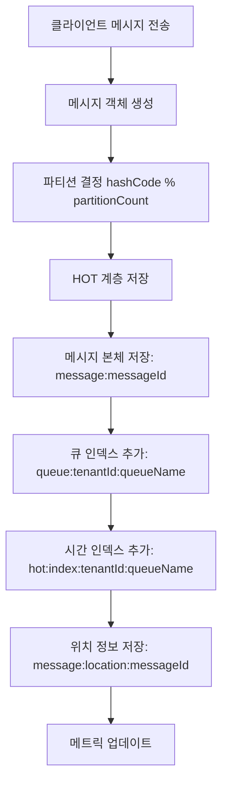
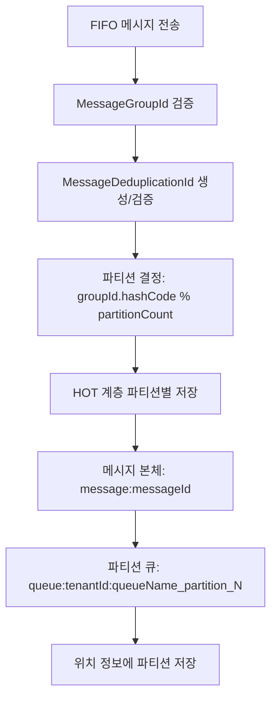
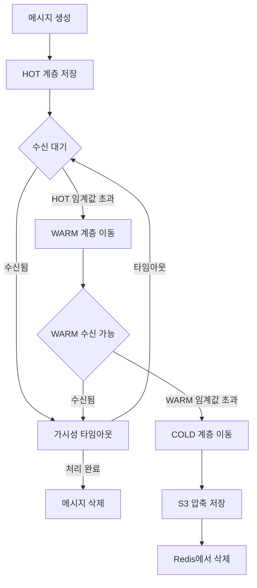

# 메시지 처리 아키텍처 (Message Processing Architecture)

## 📋 목차
1. [개요](#개요)
2. [데이터 저장 구조](#데이터-저장-구조)
3. [Standard 큐 처리 구조](#standard-큐-처리-구조)
4. [FIFO 큐 처리 구조](#fifo-큐-처리-구조)
5. [계층별 데이터 이동](#계층별-데이터-이동)
6. [파티셔닝 전략](#파티셔닝-전략)
7. [메시지 생명주기](#메시지-생명주기)

---

## 개요

Simple Queue Service는 **이중 저장 구조**와 **3계층 스토리지 시스템**을 사용하여 메시지를 효율적으로 처리합니다.

### 핵심 아키텍처 원칙
- **메시지 본체 분리**: 실제 메시지 데이터와 큐 인덱스를 분리하여 저장
- **계층별 최적화**: Hot(실시간) → Warm(단기보관) → Cold(장기보관) 계층으로 데이터 이동
- **파티셔닝**: 처리량 향상을 위한 큐 분할
- **FIFO vs Standard**: 순서 보장 여부에 따른 다른 처리 방식

---

## 데이터 저장 구조

### 1. 기본 저장 키 패턴

#### 메시지 본체 저장
```
message:{messageId}                    // 실제 메시지 JSON 데이터 (Redis Value)
message:location:{messageId}           // 메시지 위치 정보 (Redis Hash)
```

#### HOT 계층 (Redis)
```
queue:{tenantId}:{queueName}                     // Standard 큐 메시지 목록 (Redis List)
queue:{tenantId}:{queueName}_partition_{N}       // FIFO 큐 파티션별 메시지 목록 (Redis List)
hot:index:{tenantId}:{queueName}                     // 시간 기반 인덱스 (Redis ZSet)
hot:index:{tenantId}:{queueName}_partition_{N}       // FIFO 파티션별 시간 인덱스 (Redis ZSet)
```

#### WARM 계층 (Redis DISK - 아직 구현 안됨)
```
warm:queue:{tenantId}:{queueName}                    // Standard 큐 메시지 목록 (Redis ZSet)
warm:queue:{tenantId}:{queueName}_partition_{N}      // FIFO 큐 파티션별 메시지 목록 (Redis List)
warm:index:{tenantId}:{queueName}                    // 시간 기반 인덱스 (Redis ZSet)
warm:meta:{messageId}                                // 메시지 메타데이터 (Redis Hash)
```

#### COLD 계층 (로컬 디스크 - 아직 구현 안됨)
```
/data/cold/{tenantId}/{queueName}/year/month/day/batch_{timestamp}.json.gz
/data/cold/{tenantId}/{queueName}/index.json.gz
```

### 2. 메시지 위치 정보 (Hash)
```
message:location:{messageId}:
  - tier: "HOT" | "WARM" | "COLD"
  - lastMovedAt: "2025-06-20T10:30:00Z"
  - createdAt: "2025-06-20T10:00:00Z"
  - partition: "0" (FIFO 큐만)
```

---

## Standard 큐 처리 구조

### 메시지 전송 플로우



#### 1. 메시지 전송 (SendMessage)
```kotlin
// 1. 메시지 생성
val message = Message(
    messageId = UUID.randomUUID().toString(),
    messageBody = request.messageBody,
    tenantId = tenantId,
    queueName = queueName,
    sentTimestamp = Instant.now(),
    attributes = request.attributes
)

// 2. 파티션 결정 (메시지 본체 해시 기반)
val partitionNumber = messageBody.hashCode() % partitionCount

// 3. HOT 계층에 저장
// 메시지 본체
redisTemplate.opsForValue().set("message:${messageId}", messageJson, ttl)

// 큐 인덱스 (List - FIFO 순서)
redisTemplate.opsForList().rightPush("queue:${tenantId}:${queueName}", messageId)

// 시간 인덱스 (ZSet - 시간 기반 정렬)
redisTemplate.opsForZSet().add("hot:index:${tenantId}:${queueName}", messageId, timestamp)

// 위치 정보
redisTemplate.opsForHash().putAll("message:location:${messageId}", locationData)
```

#### 2. 메시지 수신 (ReceiveMessage)
```kotlin
// 1. HOT 계층에서 메시지 ID 조회 (List에서 leftPop)
val messageId = redisTemplate.opsForList().leftPop("queue:${tenantId}:${queueName}")

// 2. 메시지 본체 조회
val messageJson = redisTemplate.opsForValue().get("message:${messageId}")
val message = objectMapper.readValue(messageJson, Message::class.java)

// 3. 가시성 타임아웃 설정
redisTemplate.opsForValue().set("visibility:${messageId}", "processing", visibilityTimeout)

// 4. 인덱스에서 제거
redisTemplate.opsForZSet().remove("hot:index:${tenantId}:${queueName}", messageId)
```

### 계층 이동 (Standard 큐)

#### HOT → WARM 이동
```kotlin
// 1. 이동할 메시지 선택 (시간 또는 개수 기준)
val messagesToMove = if (countExceeded) {
    // 개수 초과: 가장 오래된 메시지들
    redisTemplate.opsForList().range("queue:${tenantId}:${queueName}", 0, moveCount-1)
} else {
    // 시간 초과: 임계값 이전 메시지들
    redisTemplate.opsForZSet().rangeByScore("hot:index:${tenantId}:${queueName}", 0, cutoffTime)
}

// 2. 메시지 이동
messagesToMove.forEach { messageId ->
    // HOT에서 제거
    redisTemplate.opsForList().remove("queue:${tenantId}:${queueName}", 1, messageId)
    redisTemplate.opsForZSet().remove("hot:index:${tenantId}:${queueName}", messageId)
    
    // WARM에 추가 (ZSet으로 변경)
    redisTemplate.opsForZSet().add("warm:queue:${tenantId}:${queueName}", messageId, timestamp)
    
    // 위치 정보 업데이트
    updateMessageLocation(messageId, "WARM")
}
```

#### WARM → COLD 이동
```kotlin
// 1. 배치 단위로 메시지 수집
val messagesToMove = redisTemplate.opsForZSet()
    .rangeByScore("warm:queue:${tenantId}:${queueName}", 0, cutoffTime)

// 2. S3에 압축 저장
val batchData = messagesToMove.map { messageId ->
    redisTemplate.opsForValue().get("message:${messageId}")
}.toList()

val compressedData = gzipCompress(objectMapper.writeValueAsString(batchData))
s3Client.putObject("cold/${tenantId}/${queueName}/batch_${timestamp}.json.gz", compressedData)

// 3. 인덱스 파일 업데이트
updateColdIndex(tenantId, queueName, messagesToMove)

// 4. WARM에서 제거
messagesToMove.forEach { messageId ->
    redisTemplate.opsForZSet().remove("warm:queue:${tenantId}:${queueName}", messageId)
    redisTemplate.delete("message:${messageId}")
    updateMessageLocation(messageId, "COLD")
}
```

---

## FIFO 큐 처리 구조

### 핵심 차이점
- **MessageGroupId 기반 파티셔닝**: 동일한 그룹 메시지는 같은 파티션
- **순서 보장**: 파티션 내에서 엄격한 FIFO 순서 유지
- **중복 제거**: ContentBasedDeduplication 옵션 지원

### 메시지 전송 플로우



#### 1. FIFO 메시지 전송
```kotlin
// 1. FIFO 필수 필드 검증
val messageGroupId = request.messageGroupId 
    ?: throw IllegalArgumentException("FIFO 큐에서 MessageGroupId는 필수입니다")

val messageDeduplicationId = request.messageDeduplicationId 
    ?: generateDeduplicationId(request.messageBody)

// 2. 중복 제거 검사 (ContentBasedDeduplication 활성화 시)
if (queue.contentBasedDeduplication) {
    val duplicateCheck = checkDuplicateMessage(messageDeduplicationId)
    if (duplicateCheck.exists) {
        return duplicateCheck.originalMessageId
    }
}

// 3. MessageGroupId 기반 파티셔닝
val partitionNumber = messageGroupId.hashCode() % partitionCount
val partitionedQueueName = "${queueName}_partition_${partitionNumber}"

// 4. 파티션별 저장
val message = Message(
    messageId = UUID.randomUUID().toString(),
    messageBody = request.messageBody,
    messageGroupId = messageGroupId,
    messageDeduplicationId = messageDeduplicationId,
    tenantId = tenantId,
    queueName = queueName,
    partition = partitionNumber.toString(),
    sentTimestamp = Instant.now()
)

// 메시지 본체 저장
redisTemplate.opsForValue().set("message:${messageId}", messageJson, ttl)

// 파티션별 큐에 추가 (엄격한 FIFO 순서)
redisTemplate.opsForList().rightPush("queue:${tenantId}:${partitionedQueueName}", messageId)

// 위치 정보 저장 (파티션 정보 포함)
val locationData = mapOf(
    "tier" to "HOT",
    "partition" to partitionNumber.toString(),
    "lastMovedAt" to Instant.now().toString(),
    "createdAt" to Instant.now().toString()
)
redisTemplate.opsForHash().putAll("message:location:${messageId}", locationData)
```

#### 2. FIFO 메시지 수신
```kotlin
// 1. 모든 파티션을 라운드로빈으로 확인
for (partitionNumber in 0 until partitionCount) {
    val partitionedQueueName = "${queueName}_partition_${partitionNumber}"
    val queueKey = "queue:${tenantId}:${partitionedQueueName}"
    
    // 파티션에서 메시지 수신 (FIFO 순서 보장)
    val messageId = redisTemplate.opsForList().leftPop(queueKey)
    if (messageId != null) {
        // 메시지 본체 조회
        val messageJson = redisTemplate.opsForValue().get("message:${messageId}")
        val message = objectMapper.readValue(messageJson, Message::class.java)
        
        // 가시성 타임아웃 설정
        setVisibilityTimeout(messageId, visibilityTimeoutSeconds)
        
        return message
    }
}
```

### FIFO 계층 이동의 특별한 처리
> ⚠️ FIFO 큐는 파티션 내 메시지 순서를 유지해야 하므로, HOT → WARM 이동 시 **파티션 수가 동일해야 합니다.**
> 파티션 수가 다르면 순서가 깨질 수 있으며, 메시지 재해싱은 권장되지 않습니다.


#### 파티션 유지 이동 (HOT → WARM)
```kotlin
// FIFO 큐의 계층 이동은 파티션별로 독립적으로 수행
fun moveMessageInPartitionedQueue(messageId: String, fromTier: String, toTier: String) {
    // 1. 메시지 위치 정보에서 파티션 번호 조회
    val locationData = redisTemplate.opsForHash<String, String>()
        .entries("message:location:${messageId}")
        .collectMap()
        .block()
    
    val partitionNumber = locationData["partition"]?.toInt() 
        ?: throw IllegalStateException("FIFO 메시지의 파티션 정보가 없습니다")
    
    // 2. 파티션별 키 생성
    val fromKey = "${fromTier.lowercase()}:queue:${tenantId}:${queueName}_partition_${partitionNumber}"
    val toKey = "${toTier.lowercase()}:queue:${tenantId}:${queueName}_partition_${partitionNumber}"
    
    // 3. 파티션 내에서만 이동 (순서 유지)
    redisTemplate.opsForList().remove(fromKey, 1, messageId)
    redisTemplate.opsForList().rightPush(toKey, messageId)
    
    // 4. 위치 정보 업데이트 (파티션 정보 유지)
    updateMessageLocation(messageId, toTier, partitionNumber)
}
```

---

## 계층별 데이터 이동

### 이동 트리거 조건

#### HOT → WARM 이동
```kotlin
// 개수 기반 이동
val countExceeded = hotStats.messageCount > HOT_MAX_COUNT (100개)

// 시간 기반 이동  
val timeExceeded = oldestMessageAge > HOT_TIME_THRESHOLD (1시간)

// 이동 실행
if (countExceeded || timeExceeded) {
    moveMessagesHotToWarm()
}
```

#### WARM → COLD 이동
```kotlin
// 개수 기반 이동
val countExceeded = warmStats.messageCount > WARM_MAX_COUNT (1000개)

// 시간 기반 이동
val timeExceeded = oldestMessageAge > WARM_TIME_THRESHOLD (24시간)

// 배치 이동 (성능 최적화)
if (countExceeded || timeExceeded) {
    moveMessagesWarmToColdInBatch()
}
```

### FIFO 특별 기능: HOT-WARM 스왑

```kotlin
// FIFO 큐만의 특별한 최적화: 메시지 교환
fun swapHotWarm(hotStats: TierStats, warmStats: TierStats) {
    val shouldSwap = hotStats.isFull && warmStats.hasOlderMessages
    
    if (shouldSwap) {
        // 각 파티션별로 스왑 수행
        for (partitionNumber in 0 until partitionCount) {
            val hotKey = "queue:${tenantId}:${queueName}_partition_${partitionNumber}"
            val warmKey = "warm:queue:${tenantId}:${queueName}_partition_${partitionNumber}"
            
            // Hot의 최신 메시지와 Warm의 오래된 메시지 교환
            val hotNewestMessages = getNewestMessages(hotKey, swapCount)
            val warmOldestMessages = getOldestMessages(warmKey, swapCount)
            
            // 상호 교환
            moveMessages(hotNewestMessages, hotKey, warmKey, "WARM")
            moveMessages(warmOldestMessages, warmKey, hotKey, "HOT")
        }
    }
}
```

---

## 파티셔닝 전략

### Standard 큐 파티셔닝
```kotlin
// 메시지 본체 기반 해시 파티셔닝
fun determinePartitionForStandard(messageBody: String, partitionCount: Int): Int {
    return Math.abs(messageBody.hashCode()) % partitionCount
}

// 장점: 균등 분산
// 단점: 순서 보장 불가
```

### FIFO 큐 파티셔닝
> 💡 수신자 또는 처리 시스템은 messageGroupId를 알고 있다면, 동일한 해싱 방식으로 대상 파티션을 정확히 계산할 수 있습니다.

```kotlin
// MessageGroupId 기반 해시 파티셔닝
fun determinePartitionForFifo(messageGroupId: String, partitionCount: Int): Int {
    return Math.abs(messageGroupId.hashCode()) % partitionCount
}

// 장점: 동일 그룹 메시지의 순서 보장
// 단점: 그룹 분산에 따른 핫스팟 가능성
```

### 파티션 관리
```kotlin
// 파티션별 독립적인 처리
class QueuePartitioningService {
    fun getPartitionedQueueName(queueName: String, partitionNumber: Int): String {
        return "${queueName}_partition_${partitionNumber}"
    }
    
    fun getPartitionNumber(message: Message): Int {
        return if (message.queueType == "FIFO") {
            determinePartitionForFifo(message.messageGroupId!!, partitionCount)
        } else {
            determinePartitionForStandard(message.messageBody, partitionCount)
        }
    }
}
```

---

## 메시지 생명주기

### 전체 플로우


### 메시지 상태 추적
```kotlin
data class MessageLocation(
    val tier: StorageTier,           // HOT, WARM, COLD
    val lastMovedAt: Instant,        // 마지막 이동 시간
    val createdAt: Instant,          // 생성 시간
    val partition: String? = null    // FIFO 큐의 파티션 번호
)

enum class StorageTier {
    HOT,    // Redis List/ZSet (실시간 처리)
    WARM,   // Redis ZSet (단기 보관)
    COLD    // S3 압축 파일 (장기 보관)
}
```

### 메시지 복원 (COLD → WARM → HOT)
```kotlin
// 관리자가 오래된 메시지를 다시 활성화하고 싶을 때
fun promoteMessage(messageId: String, targetTier: String) {
    val currentLocation = getMessageLocation(messageId)
    
    when {
        currentLocation.tier == COLD && targetTier == "HOT" -> {
            // S3에서 메시지 복원
            val messageData = s3Client.getObject("cold/.../batch_${timestamp}.json.gz")
            val messages = decompressAndParse(messageData)
            val message = messages.find { it.messageId == messageId }
            
            // HOT 계층으로 복원
            restoreMessageToHot(message)
        }
        // 기타 복원 시나리오...
    }
}
```

---

## 성능 최적화 전략

### 1. 배치 처리
- **WARM → COLD**: 1000개 단위 배치 압축 저장
- **메시지 수신**: 파티션별 라운드로빈 조회
- **계층 이동**: 파티션별 병렬 처리

### 2. 캐싱 최적화
- **메시지 위치 정보**: Hash 구조로 빠른 조회
- **큐 통계**: Redis에서 실시간 계산
- **인덱스 활용**: ZSet의 시간 기반 범위 조회

### 3. 메모리 최적화
- **TTL 설정**: 계층별 적절한 만료 시간
- **압축 저장**: COLD 계층의 gzip 압축
- **메타데이터 분리**: 본체와 메타데이터 독립 저장

이 아키텍처를 통해 대용량 메시지 처리와 효율적인 스토리지 관리, 그리고 FIFO/Standard 큐의 특성에 맞는 최적화된 처리가 가능합니다.

---

## 고급 파티셔닝 처리 전략

### 🔁 HOT → WARM 이동 시 파티션 수 차이 대응

- `HOT`과 `WARM` 계층은 서로 다른 파티션 수를 가질 수 있음
  - `HOT` 트래픽 증가로 병렬처리가 많이 필요하게 될 수 있음.
- 이 경우, FIFO 큐의 경우, HOT과 WARM의 파티션 수가 다를 수 있으므로,
messageGroupId를 기준으로 WARM의 파티션을 다시 해싱하여 결정해야 함

```kotlin
val newWarmPartition = Math.abs(messageGroupId.hashCode()) % warmPartitionCount
```

### 2. 📦 **파티션 내에 여러 groupId가 섞인 경우, groupId 기반 조회 방법 누락**
- 문서에 메시지 본문에 groupId가 있다고 명시되어 있지만,  
  → **파티션 내에서 특정 groupId만 조회/처리하는 방식**은 설명이 부족합니다.

**보완 제안:**

#### 🎯 파티션 내 groupId별 메시지 필터링 전략
> 예: 특정 유저 또는 채팅방의 메시지만 조회하고 싶을 경우, groupId 기반 필터링이 필요


- 메시지가 본문에 groupId를 포함하고 있을 경우, Redis 키로 직접 필터링이 불가능함
- 이를 해결하기 위한 전략:

1. **애플리케이션 측 필터링**:
   - 전체 메시지를 `LRANGE` 또는 `ZRANGE`로 가져온 후 groupId로 필터링
   - 단순하지만 메시지 수가 많을 경우 성능 저하

2. **GroupId별 서브 큐 구조**:
   - `queue:{partitionId}:{groupId}` 구조로 메시지를 분리 저장
   - groupId 단위로 직접 조회 가능 (고속)
   - 대신 key-space 폭증 위험 → TTL 또는 정리 작업 필요

3. **인덱스 기반 접근**:
   - 파티션에 대해 groupId + messageId를 `ZSet`으로 저장
   - 메시지는 `messageId`로 별도 조회
   - 읽기 성능은 좋지만 복잡성 증가

### ⚠ Redis key-space 증가 방지 전략

- 메시지를 groupId별로 Redis key로 저장할 경우, 사용자에 따라 Redis key 수가 기하급수적으로 증가할 수 있음

**해결 방안**:
- `TTL 설정`: groupId 큐에 만료시간 지정
- `정리 작업`: 사용되지 않는 groupId 큐는 주기적으로 삭제
- `서브 큐 최소화`: 가능하다면 파티션 큐에서 groupId를 메시지 필드로만 관리